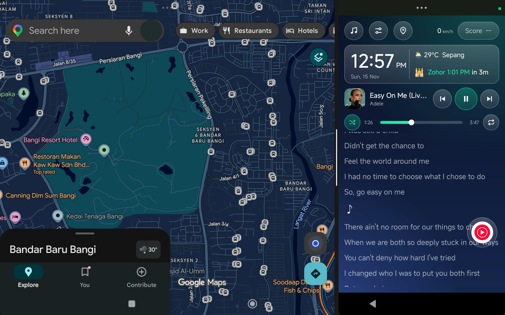
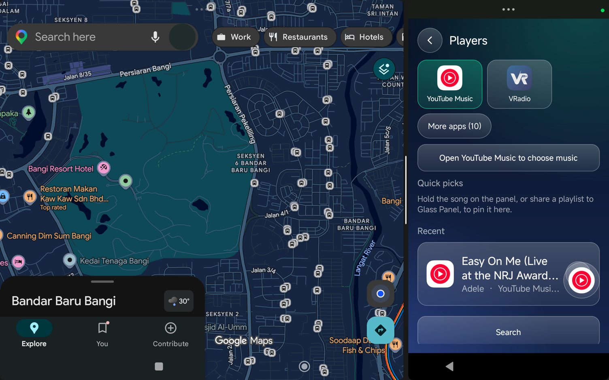
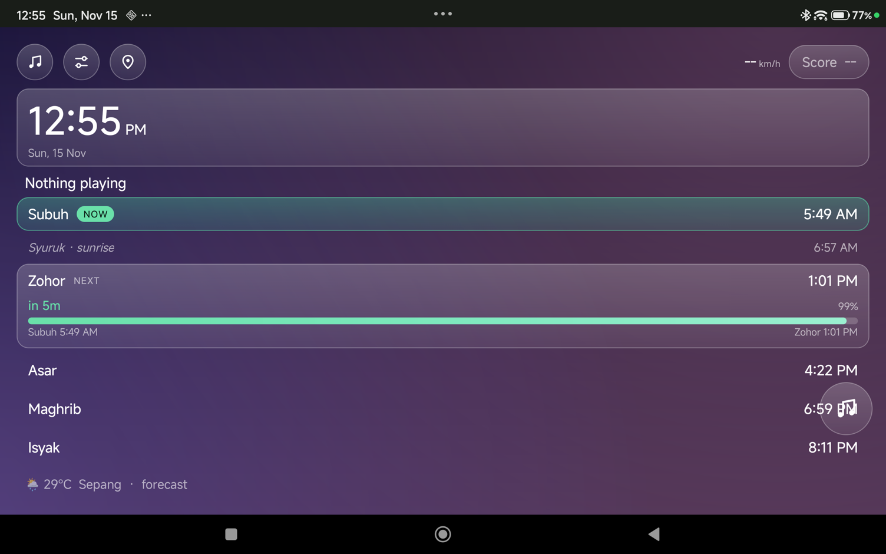
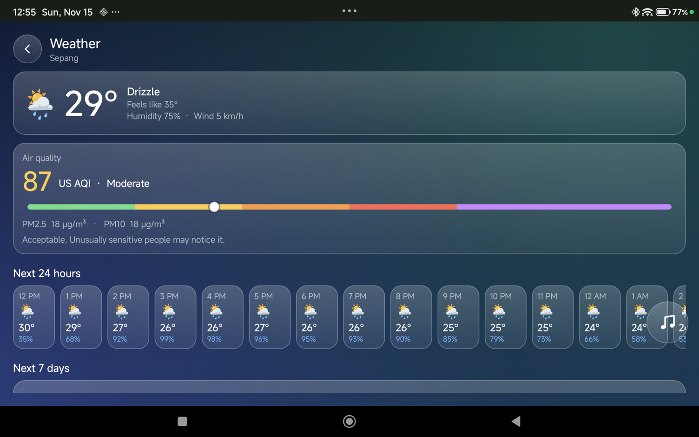
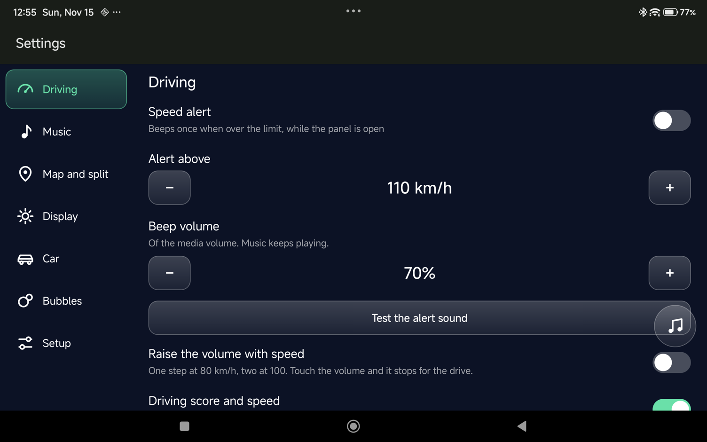

# Glass Panel

A side panel for Android car head units. It sits beside Google Maps or Waze in split-screen and keeps everything else you glance at while driving on one big, easy-to-tap screen:

- the song that's playing, with lyrics that scroll along;
- prayer times for where you are;
- the weather;
- your driving score and speed.

<p align="center">
  
</p>

It's built for Malaysian roads and runs on Android 12 or newer. In daily use on a **Carlinkit Ultra 2** and an **Eonon UX7ST**.

## Features

### Music

- **Now playing:** the song and its cover from whatever player is running (YouTube Music, Spotify, VRadio and others), with **synced lyrics** that scroll along.
  - Swipe the song to skip.
  - Shuffle and repeat are remembered for each player.
- **Switching players:** the player picker starts with your **Quick picks**: playlists and radio stations you pinned.
  - To pin something, hold the song for a second, or share a YouTube Music or Spotify playlist to Glass Panel.
  - **Recent** and **Search** sit underneath the Quick picks.
- **Auto-play:** starts the last player when the car starts.

<p align="center">
  
</p>

### Prayer times

- **Times for where you are:** they follow the car, by JAKIM zone, with a countdown to the next prayer.
- **When nothing is playing:** the panel shows the day's prayer table, and its colours follow the time of day.

<p align="center">
  
</p>

### Weather

- **Weather where you are:** the current weather, an hourly and weekly forecast, and air quality.
- **Rain heads-up:** "🌧 Rain likely from 5 PM" appears in the weather line before it starts.

<p align="center">
  
</p>

### Driving

- **Driving score and speed:** an eco score for each drive, with charts for the week, month and year.
- **Speed alert:** one beep when you go over your limit. The music keeps playing.
- **Volume that rises with speed** (optional): one step up at 80 km/h and another at 100 km/h. If you change the volume yourself, it leaves it alone for the rest of the drive.
- **Start-of-drive summary:** a short card when the car starts. It shows the weather, the next prayer, and the last drive's time and fuel cost, with and without BUDI95.
- **Android Auto button:** opens AutoKit or Xlink full screen.


### Made for the car

- **Big controls:** big buttons and text, in a light, dark or **Sun** theme. Sun is dark from Maghrib to Syuruk.
- **Settings you can use while driving:** groups on a rail, with large switches and − / + buttons.
- **Floating bubbles:** optional, for media and apps, on top of any app.
- **Split-screen by itself:** with the window helper on, the screen splits into the map and the panel at start-up.

<p align="center">
  
</p>

## Install

### 1. Get the APK

Download the newest `GlassSidePanel-…-headunit.apk` from the [Releases page](https://github.com/maohisham/glass-auto-sidepanel-launcher/releases/latest).

Each release has the same signature, so a newer one installs over an older one without uninstalling. Your settings and pins stay.

### 2. Put it on the unit

- **With adb** (Carlinkit and most Android boxes):

  ```bash
  adb install -r GlassSidePanel-<version>-headunit.apk
  ```

- **Without adb** (Eonon and most head units):
  - Open the Releases page in the unit's browser and download the APK, then tap it.
  - Or copy it to Google Drive and open it in Drive on the unit.
  - The first time, allow "install unknown apps" for the browser or for Drive.

### 3. Turn things on

Open Glass Panel, then **Settings → Setup**. The checklist shows what's still missing, and its **Allow** buttons go straight to the right page:

1. **Media access** (notification access): needed to show what's playing and the lyrics.
2. **Location:** prayer times, weather and the speed follow the car.
3. **Display over other apps:** only for the floating bubbles.
4. **Window helper** (Accessibility → Glass Panel): splits the screen by itself at start-up, and opens Android Auto full screen.

### 4. Keep it running

Many head units close apps when the car is switched off, and Android then switches the window helper off as well. If the helper keeps turning itself off:

- add Glass Panel to the unit's keep-alive or auto-start list, if it has one;
- set its battery use to **Unrestricted** (App info → Battery).

After a car start, **Settings → Setup → Open the log** shows why the app last stopped.

### Updating

Download the newer APK and install it the same way. There's no need to uninstall first.

## Privacy

Glass Panel has no account and no analytics. It contacts these services only:

| For | Service | What's sent |
|---|---|---|
| Prayer times | e-solat.gov.my (JAKIM), waktusolat.app, aladhan.com | Your zone, or your approximate location |
| Weather and air quality | open-meteo.com | Your approximate location |
| Lyrics | lrclib.net, lyrics.ovh, music.163.com | The song's title and artist |
| Fuel prices | data.gov.my | Nothing: it reads the public weekly prices |

It reads the notifications of **Google Maps and Waze only**, and only into its own on-screen log. It never reads messages or other apps' notifications. Media access is used to see what's playing.

## Building it yourself

You need JDK 17 and the Android SDK. Put the SDK's path in `local.properties` as `sdk.dir=...`.

```bash
./gradlew :headunit:testDebugUnitTest   # unit tests
./gradlew :headunit:assembleDebug       # headunit/build/outputs/apk/debug/headunit-debug.apk
```

### Signing

Release builds are signed with a key in `headunit/keystore/`, which isn't in git. To make one:

```bash
keytool -genkeypair -keystore headunit/keystore/headunit.jks -alias headunit -keyalg RSA -keysize 2048 -validity 10000
```

Then create `headunit/keystore/keystore.properties`:

```
storeFile=keystore/headunit.jks
storePassword=...
keyAlias=headunit
keyPassword=...
```

Back both files up outside this folder. Without them, the build falls back to the debug key, and an APK signed with a different key can't install over one already on the unit. Never commit them.

### Project layout

| Folder | What it is |
|---|---|
| `headunit/` | The app (package `com.glass.headunit`) |
| `docs/superpowers/` | Design notes and implementation plans for each release |
| `docs/unit-notes.md` | What was found while testing on each unit |
| `docs/screenshots/` | The pictures in this README |
